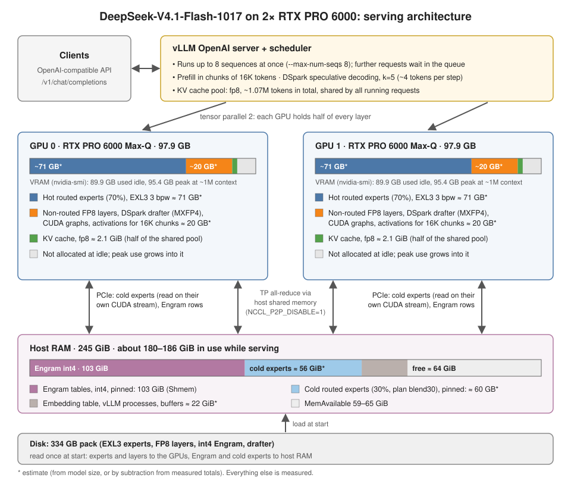

English | [简体中文](README.zh-CN.md)

# DeepSeek-V4.1-Flash-1017 on 2× RTX PRO 6000 (1M context, ~90–110 tok/s, no Docker, no root)

Scripts and measurements for serving **[DeepSeek-V4.1-Flash-1017](https://huggingface.co/deepseek-ai/DeepSeek-V4.1-Flash-1017)**
with the **full 1M-token context** on two RTX PRO 6000 Blackwell Max-Q cards (96 GB each, PCIe, no NVLink). The setup
needs no Docker and no root.

| | |
|---|---|
| Single-stream decode | **89–112 tok/s** from 2K to 890K-token prompts (DSpark speculative decoding) |
| Aggregate decode | 117–141 tok/s with 2 streams, 132–162 tok/s with 4 |
| Prefill | ~5,000 tok/s; an 890K-token prompt takes ~3 min |
| Long context | needle found 15/15 from 24K to 1.0M tokens |
| Quality, thinking off | GSM8K 99%, MATH-500 88% (96% thinking on), HumanEval 98%, MMLU-Pro 75%, C-Eval 93%, tool calls 10/10 |

Full numbers: [results/README.md](results/README.md). How requests, GPU memory and host RAM fit together:
[docs/ARCHITECTURE.md](docs/ARCHITECTURE.md).

## Quickstart: ready-to-run on Hugging Face

The finished pack and a prebuilt runtime overlay are on Hugging Face as
**[cliecy/DeepSeek-V4.1-Flash-1017-EXL3-3bpw-2xRTXPRO6000](https://huggingface.co/cliecy/DeepSeek-V4.1-Flash-1017-EXL3-3bpw-2xRTXPRO6000)**.
The overlay (~50 MB) holds only the files this setup adds to the official vLLM image: the patched vLLM files,
vllm-exl3, ExLlamaV3 and the compiled kernels. `run.sh` pulls the image itself by digest, so no NVIDIA libraries are
redistributed.

```bash
hf download cliecy/DeepSeek-V4.1-Flash-1017-EXL3-3bpw-2xRTXPRO6000 --local-dir dsv41-1017
bash dsv41-1017/run.sh        # checks the host, sets up the runtime once (~4 min on NVMe), serves http://127.0.0.1:8000/v1
```

This repository is for rebuilding all of that from the upstream sources, and for the benchmarks.

This repository contains no new model weights and no new serving engine. It combines existing work:

- **[diffbot/DeepSeek-V4.1-Flash-EXL3-3bpw-2x-RTX-PRO-6000](https://huggingface.co/diffbot/DeepSeek-V4.1-Flash-EXL3-3bpw-2x-RTX-PRO-6000)**:
  the serving recipe (vLLM patches, the xmoe kernels, host-RAM cold experts, int4 Engram, and the serve / quantize
  scripts). It was built for the legacy V4.1-Flash on exactly this hardware.
- **[PixelML/DeepSeek-V4.1-Flash-1017-EXL3-3bpw](https://huggingface.co/PixelML/DeepSeek-V4.1-Flash-1017-EXL3-3bpw)**:
  the 1017 routed experts in the same EXL3 3 bpw format.

Our additions:
- a pack layout for 1017 (int4 Engram from the 1017 shards, drafter kept in source format);
- a rootless runtime: the official vLLM image unpacked with `crane` and run under `bubblewrap`, instead of Docker;
- two fixes found on our host (`NCCL_P2P_DISABLE=1`, exact-size pinned allocations);
- the benchmark suite and its results.

## Why it works for 1017

- **Same architecture.** The legacy V4.1-Flash and the 1017 `config.json` are identical, and so are their 96,085
  tensor names. Only the weights changed, so the diffbot stack needs no code changes.
- **Same format.** PixelML's 1017 pack matches coolbho3k's legacy pack, which diffbot serves: `quant_method: exl3`, MUL1
  codebook, K=3 trellis tiles, FP8 non-routed layers.
- **What differs from diffbot's pack:**
  - PixelML's experts are uncalibrated.
  - PixelML ships no Engram tables. The legacy tables do **not** match 1017, so we convert the official 1017 shards 47-48.
  - The DSpark drafter stays MXFP4. The vllm-exl3 plugin supports this with `mtp_experts: "source"` and
    `mtp_experts_start_layer: 40`.
- **Not drop-in:** LibertAIDAI's 1017 EXL3 packs (2.9 / 3.5 bpw) quantize every layer in exllamav3's native layout.
  They target a different serving kit and do not load in this stack.

## Requirements

- 2× sm_120 GPUs with 96 GB each, NVIDIA driver with CUDA 13 support (tested: 595.91.07 / CUDA 13.2).
- **Host RAM:** ~245 GiB total. Serving pins 103 GiB of int4 Engram tables plus the cold experts (~60 GB, estimate),
  and needs ~190 GiB in total. The Engram conversion peaks at ~121 GiB RSS.
- **Disk:** ~540 GB on one filesystem for the models (~335 GB after deleting the FP8 Engram shards), plus ~30 GB for the
  rootfs and build tree. NVMe makes cold starts much faster (see Known issues).
- Linux with unprivileged user namespaces available to `bwrap` (bubblewrap ≥ 0.8). Also `curl`, `git`, `python3`, and
  [`uv`](https://github.com/astral-sh/uv) or the `hf` CLI.

## Step by step

All scripts read `scripts/env.sh`, and any variable there can be overridden. The two that matter:

```bash
export WORK=/fast/disk/dsv41-1017       # rootfs, recipe, sources, caches, logs (default: $HOME/dsv41-1017)
export MODELS_DIR=/big/disk/models      # downloads + the assembled pack, one filesystem (default: $WORK/models)
```

### 1. Runtime and sources: `scripts/fetch.sh` (~10 min)

- Downloads `crane` and exports the pinned vLLM image to `$WORK/rootfs`.
- Fetches the diffbot recipe at its pinned revision to `$WORK/recipe`.
- Clones vllm-exl3, ExLlamaV3 and the sfxnz recipe at their pinned commits.

### 2. Build: `scripts/build-bwrap.sh` (~30 min, CPU only)

The same steps as the recipe's `docker/build.sh` and `kernels/build.sh`, applied to the rootfs in place: apt deps, the six
vLLM patches, vllm-exl3 + `exl3-thor.patch`, ExLlamaV3 for `sm_120a`, and the xmoe / xmoe_do kernels.

To check it:

```bash
scripts/ctr.sh -- python3 -c "import vllm, vllm_exl3, exllamav3_ext; print(vllm.__version__)"
```

### 3. Weights: `scripts/download.sh` (~430 GB)

| What | Revision | Size |
|---|---|---|
| `PixelML/DeepSeek-V4.1-Flash-1017-EXL3-3bpw` (all files) | `3d095b72` | 223 GB |
| `deepseek-ai/DeepSeek-V4.1-Flash-1017` shards 47-48 (Engram, FP8), plus `config.json`, index, tokenizer, `encoding/` | `1bae0e10` | 203 GB |

The official Engram shards are verified with these checksums:

```
76a05106ece259be83d1bfea0dcb54f23377864ee60fd321690f35e6698a2af5  model-00047-of-00048.safetensors
9dc51433e195bc78b5ad846b68643cc0351d3b174e5e4309222d3b7402c83afd  model-00048-of-00048.safetensors
```

### 4. Pack: `scripts/prepare_pack.sh` (~50 min, CPU only, peak RSS ~121 GiB)

1. Checks the sha256 above.
2. Converts the Engram tables to packed int4 with fp16 per-32 scales, using the recipe's unchanged
   `quantize/convert_engram_int4.py`: 203 GB → 111 GB, first-chunk relative error 0.089.
3. Assembles `$MODELS_DIR/DeepSeek-V4.1-Flash-1017-EXL3-3bpw-thor` with hardlinks (`assemble_pack_1017.py`):
   - PixelML shards 1-46 and the int4 Engram shards 47-48;
   - the index is rebuilt from the shard headers, because PixelML's index lists `.mcg` tensors that its shards do not contain;
   - `config.json` is diffbot's, with the drafter switched to source-format experts.
4. Creates `…-thor-drafter`, a directory with only the drafter shards 44-46 (see `DRAFT_PACK` below).

Afterwards you can delete `$MODELS_DIR/DeepSeek-V4.1-Flash-1017-src/model-0004[78]*` (203 GB).

### 5. Serve: `scripts/serve-bwrap.sh`

```bash
API_KEY=change-me HOST=127.0.0.1 PORT=8000 scripts/serve-bwrap.sh
curl -s localhost:8000/health
curl -s localhost:8000/v1/chat/completions -H "Authorization: Bearer change-me" -H 'Content-Type: application/json' \
  -d '{"model":"deepseek-v4.1-flash-1017","messages":[{"role":"user","content":"Hello"}],"chat_template_kwargs":{"thinking":false}}'
```

- The server is OpenAI-compatible, including tool calls, the reasoning parser and image input.
- Thinking is controlled per request with `chat_template_kwargs: {"thinking": true|false}`, or for every request with
  `THINKING=off`.
- It runs in the foreground; SIGTERM / Ctrl-C stops it.

Settings beyond diffbot's defaults (all overridable):

| Variable | Default | Why |
|---|---|---|
| `NCCL_P2P_DISABLE` | `1` | On our host, NCCL's P2P transport hangs in the first all-reduce: GPU0-GPU1 PHB, IOMMU enabled, no `iommu=pt` (that cause is a guess). `scripts/nccl_test.py` reproduces it: with P2P the test never returns; without it, it finishes in ~1 s. With P2P off, the TP all-reduce goes through host shared memory. If `nccl_test.py` passes with P2P on (try booting with `iommu=pt`, or disabling ACS), set `NCCL_P2P_DISABLE=0` and expect faster prefill. |
| `PIN_ROUND_MB` | `1024` | Sets `PYTORCH_CUDA_ALLOC_CONF=…pinned_max_round_threshold_mb:1024`. torch 2.13's pinned host allocator rounds every allocation up to a power of two. For the int4 Engram tables (22.9 + 2.9 GiB per layer and rank) that wastes ~41 GiB, and the host would not fit. With this setting, Shmem was 103 GiB and host use ~190 GiB, against ~230 GiB in the diffbot recipe. |
| `PLAN` | `plan-blend30-dh.json` | Which 30% of the experts live in host RAM. These plans were chosen from **legacy** routing statistics: `agent30` suits long agentic sessions, `gen30` short synthetic prompts, `blend30` is in between. All results here used blend30. A 1017-specific plan (`EXL3_EXPERT_STATS` + the recipe's `plans/make_plan.py`) should do better. |
| `DRAFT_PACK` | empty | **Untested.** Points the DSpark draft model at `…-thor-drafter`. vLLM loads the draft model by reading its whole checkpoint directory, so with the full pack it re-reads all 311 GB, ~23 of the ~85 cold-start minutes on HDD. |
| `HOST`, `PORT`, `SERVED`, `CACHE_DIR` | `127.0.0.1`, `8000`, `deepseek-v4.1-flash-1017`, `$WORK/cache` | |
| `DRY_RUN` | `0` | `1` prints the exact server command (API key masked) and exits. |

Everything else (`MAX_MODEL_LEN`, `KV_MEM`, `SPEC_K`, `VISION`, `THINKING`, `THOR_*`, `EXL3_*`, …) behaves as in the
recipe's `serve/serve.sh`. The recipe's `README.md` explains each setting.

Optional:
- `scripts/share-acl.sh` lets a second local account (e.g. a service user) run the server from this tree read-only.
- `scripts/monitor.sh` logs RAM and VRAM during a launch.

## Architecture



- vLLM runs up to 8 requests at once (`--max-num-seqs 8`); more wait in its queue. All running requests share one fp8
  KV pool of ~1.07M tokens, so a single 1M-token request fills it.
- Each GPU (TP2) holds half of every layer: 70% of the routed experts (~71 GB, estimate), the FP8 non-routed layers,
  the drafter and CUDA graphs. The other 30% of the experts and the int4 Engram tables live in pinned host RAM and are
  read over PCIe. The all-reduce between the two GPUs goes through host shared memory.
- One stream decodes at 89–112 tok/s, two at 59–70 tok/s each; total throughput stops growing after about 4 streams.

Details, memory tables and tuning knobs: [docs/ARCHITECTURE.md](docs/ARCHITECTURE.md).

## llama.cpp / GGUF route

We also ran the model as a GGUF with llama.cpp on the same two GPUs, on top of the unmerged DeepSeek V4.1 PR
[ggml-org/llama.cpp#28696](https://github.com/ggml-org/llama.cpp/pull/28696). That needed 7 patches (long-context
candidate selection, faster indexer and decode, multi-GPU and `llama-imatrix` fixes) plus `-ts 48,52` on 2 GPUs. With
them, single-stream decode of a Q2_K GGUF at 16K context went from 23 to 45 tok/s. The patches are in
[`patches/llama.cpp/`](patches/llama.cpp/); what each one does, how to build, and the numbers:
[docs/LLAMACPP-FIXES.md](docs/LLAMACPP-FIXES.md).

## Benchmarks

`results/eval/run_all.sh` runs the speed, needle and quality suites against a running server (see
[results/README.md](results/README.md)). `results/eval/make_samples.py` rebuilds the fixed samples from Hugging Face
datasets; the datasets are not redistributed here.

## Known issues

- **Prefill is ~5K tok/s, half of the ~10K the diffbot card reports on the same GPUs.** We think the cause is mostly the
  host-memory all-reduce forced by `NCCL_P2P_DISABLE=1`; this was not measured. Decode is likely affected by a few percent at most.
- **Cold start takes ~85 min from an HDD:**
  - 23 min to read 311 GB;
  - 35 min of re-reads during weight post-processing, because free RAM is too small to keep the page cache;
  - ~23 min for the drafter, which re-reads the whole checkpoint.

  NVMe for the pack and `DRAFT_PACK` should cut most of this.
- **Thinking mode sometimes reasons past 16K tokens** under concurrency (HumanEval 5/50, MMLU-Pro 9/64). Re-run one at
  a time, most of these finish normally. DeepSeek recommends `max_tokens` ≥ 256K.
- **4 concurrent streams get only 33–40 tok/s each.** The cold-expert plan is not tuned for 1017.
- **Quality is only spot-checked.** n = 50–200 per benchmark, and the routed experts are uncalibrated. No KL or perplexity
  measurement against the original model.

## Pinned versions

| Component | Version |
|---|---|
| vLLM image | `vllm/vllm-openai@sha256:8896fd7b29fc4ee7ce839f146cb4757984c476ec79d0234ffa8c995dee6e339a` (nightly-5555a2d8, vLLM 0.31.1rc1.dev376+g5555a2d8f, torch 2.13.0+cu130, FlashInfer 0.7.0.post1, NCCL 2.30.7) |
| diffbot recipe | `diffbot/DeepSeek-V4.1-Flash-EXL3-3bpw-2x-RTX-PRO-6000@6062be5f0f43c50ba562ef4e7087d4fc83eea36c` (`recipe/`, `config.json`) |
| vllm-exl3 | `vcruz305/vllm-exl3@d3cfd394920360d69f820d2dc96f8292a9e10283` + the recipe's `patches/vllm-exl3/exl3-thor.patch` |
| ExLlamaV3 | `turboderp-org/exllamav3@5be886578ec80324c2c715269387be2058724b6e` |
| sfxnz recipe | `sfxnz/DeepSeek-V4.1-Flash-EXL3-vLLM-2x-DGX-Spark@460ac89c7df1eea4db8a731f1feb807f1584f359` (`docker/patch` helpers) |
| Weights | `PixelML/DeepSeek-V4.1-Flash-1017-EXL3-3bpw@3d095b724ed4f3abb519cc1cda64c290a0e0b0c5`, `deepseek-ai/DeepSeek-V4.1-Flash-1017@1bae0e1088993b9b82de08f59de5be5a34e42170` |
| crane | go-containerregistry v0.22.1 |

## Repository layout

| Path | Contents |
|---|---|
| `scripts/` | `env.sh` (settings), `fetch.sh`, `build-bwrap.sh`, `download.sh`, `prepare_pack.sh` + `assemble_pack_1017.py`, `serve-bwrap.sh`, `ctr.sh` (bubblewrap runner), `share-acl.sh`, `nccl_test.py`, `monitor.sh` |
| `patches/` | How our derived scripts differ from the diffbot recipe files they started from (`serve.sh`, `docker/build.sh`, `quantize/assemble_pack.py`). For reference only; the scripts in `scripts/` are complete. |
| `patches/llama.cpp/` | 7 patches for the GGUF route, to apply on top of llama.cpp PR #28696 (see [docs/LLAMACPP-FIXES.md](docs/LLAMACPP-FIXES.md)) |
| `results/` | Benchmark report ([English](results/README.md), [Chinese](results/REPORT.zh.md)), `summary.json`, per-run and per-item data, eval harness |
| `docs/` | Architecture notes and diagram ([English](docs/ARCHITECTURE.md), [Chinese](docs/ARCHITECTURE.zh-CN.md)); llama.cpp fixes ([English](docs/LLAMACPP-FIXES.md), [Chinese](docs/LLAMACPP-FIXES.zh-CN.md)) |

## Credits

- **DeepSeek-AI**: DeepSeek-V4.1-Flash-1017 (MIT).
- **diffbot**: the 2× RTX PRO 6000 serving recipe: vLLM sm_120 fixes, xmoe / xmoe_do kernels, host-RAM experts, int4
  Engram, and the serve, build and quantize scripts.
- **PixelML**: the 1017 EXL3 3 bpw quantization.
- **coolbho3k**: the original V4.1-Flash EXL3 3 bpw pack and settings.
- **sfxnz**: the V4.1 EXL3 vLLM recipe for 2× DGX Spark.
- **turboderp**: ExLlamaV3.
- **vcruz305 and Mia's AI Lab**: vllm-exl3.
- **The vLLM and FlashInfer teams.**

See [NOTICE.md](NOTICE.md) for licenses.
