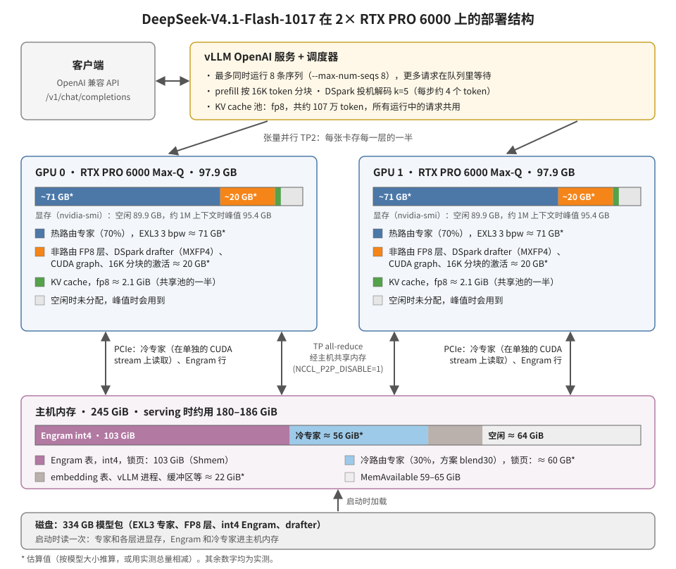

[English](README.md) | 简体中文

# 在 2× RTX PRO 6000 上运行 DeepSeek-V4.1-Flash-1017（1M 上下文，约 90–110 tok/s，不用 Docker，不用 root）

本仓库提供脚本和实测数据，用两张 RTX PRO 6000 Blackwell Max-Q（每张 96 GB，PCIe 连接，没有 NVLink）运行
**[DeepSeek-V4.1-Flash-1017](https://huggingface.co/deepseek-ai/DeepSeek-V4.1-Flash-1017)**，支持**完整的 1M token 上下文**。
整套部署不需要 Docker，也不需要 root。

| | |
|---|---|
| 单路 decode | 从 2K 到 890K token 的 prompt，**89–112 tok/s**（DSpark 投机解码） |
| 多路 decode 总速度 | 2 路 117–141 tok/s，4 路 132–162 tok/s |
| prefill | 约 5,000 tok/s；890K token 的 prompt 约需 3 分钟 |
| 长上下文 | 大海捞针从 24K 到 1.0M token，15/15 全部找到 |
| 质量（思考关） | GSM8K 99%，MATH-500 88%（思考开 96%），HumanEval 98%，MMLU-Pro 75%，C-Eval 93%，工具调用 10/10 |

完整评测结果：[results/REPORT.zh.md](results/REPORT.zh.md)（英文版和数据文件说明：[results/README.md](results/README.md)）。
请求、显存和主机内存如何安排：[docs/ARCHITECTURE.zh-CN.md](docs/ARCHITECTURE.zh-CN.md)。

## 快速开始：直接从 Hugging Face 下载可运行的版本

组装好的模型包和预编译的运行环境 overlay 放在 Hugging Face：
**[cliecy/DeepSeek-V4.1-Flash-1017-EXL3-3bpw-2xRTXPRO6000](https://huggingface.co/cliecy/DeepSeek-V4.1-Flash-1017-EXL3-3bpw-2xRTXPRO6000)**。
overlay（约 50 MB）只包含本方案在官方 vLLM 镜像之上新增的文件：打过补丁的 vLLM 文件、vllm-exl3、ExLlamaV3
和编译好的内核。`run.sh` 会按 digest 自己拉取镜像，因此不再分发任何 NVIDIA 库。

```bash
hf download cliecy/DeepSeek-V4.1-Flash-1017-EXL3-3bpw-2xRTXPRO6000 --local-dir dsv41-1017
bash dsv41-1017/run.sh        # checks the host, sets up the runtime once (~4 min on NVMe), serves http://127.0.0.1:8000/v1
```

（`run.sh` 会检查主机，第一次运行时搭好运行环境，在 NVMe 上约 4 分钟，然后在 http://127.0.0.1:8000/v1 提供服务。）

本仓库用来从上游源码重建上面这一切，并存放评测。

本仓库不包含新的模型权重，也没有新的推理引擎，而是把已有的工作组合起来：

- **[diffbot/DeepSeek-V4.1-Flash-EXL3-3bpw-2x-RTX-PRO-6000](https://huggingface.co/diffbot/DeepSeek-V4.1-Flash-EXL3-3bpw-2x-RTX-PRO-6000)**：
  部署方案本身（vLLM 补丁、xmoe 内核、放在主机内存里的冷专家、int4 Engram，以及 serve / quantize 脚本）。
  它是为 legacy V4.1-Flash 在完全相同的硬件上做的。
- **[PixelML/DeepSeek-V4.1-Flash-1017-EXL3-3bpw](https://huggingface.co/PixelML/DeepSeek-V4.1-Flash-1017-EXL3-3bpw)**：
  同样是 EXL3 3 bpw 格式的 1017 路由专家。

我们新增的部分：
- 1017 的模型包布局（int4 Engram 由 1017 的 shard 转换而来，drafter 保持原格式）；
- 不需要 root 的运行环境：用 `crane` 解包官方 vLLM 镜像，在 `bubblewrap` 里运行，代替 Docker；
- 在我们的机器上发现的两个修复（`NCCL_P2P_DISABLE=1`，锁页内存按实际大小分配）；
- 评测脚本和评测结果。

## 为什么这套方案适用于 1017

- **架构相同。** legacy V4.1-Flash 和 1017 的 `config.json` 完全一样，96,085 个 tensor 名称也一样。只有权重变了，
  所以 diffbot 的方案不需要改代码。
- **格式相同。** PixelML 的 1017 包和 coolbho3k 的 legacy 包（diffbot 用的就是这个）格式一致：`quant_method: exl3`、
  MUL1 codebook、K=3 trellis tile、非路由层为 FP8。
- **和 diffbot 的包不同的地方：**
  - PixelML 的专家没有校准。
  - PixelML 没有提供 Engram 表。legacy 的 Engram 表和 1017 **不匹配**，所以我们转换 1017 官方的 shard 47-48。
  - DSpark drafter 保持 MXFP4。vllm-exl3 插件通过 `mtp_experts: "source"` 和 `mtp_experts_start_layer: 40` 支持这种情况。
- **不能直接替换：** LibertAIDAI 的 1017 EXL3 包（2.9 / 3.5 bpw）把所有层都按 exllamav3 的原生布局量化，
  面向的是另一套部署工具，在本方案里加载不了。

## 环境要求

- 2 张 sm_120 GPU，每张 96 GB；NVIDIA 驱动支持 CUDA 13（测试用：595.91.07 / CUDA 13.2）。
- **主机内存：** 共约 245 GiB。serving 时锁页 103 GiB 的 int4 Engram 表，再加上冷专家（约 60 GB，估算），
  总共需要约 190 GiB。Engram 转换时 RSS 峰值约 121 GiB。
- **磁盘：** 模型需要同一个文件系统上约 540 GB 空间（删掉 FP8 Engram shard 后约 335 GB），rootfs 和编译目录另需约 30 GB。
  用 NVMe 冷启动会快得多（见已知问题）。
- Linux，`bwrap`（bubblewrap ≥ 0.8）能使用非特权 user namespace。另外需要 `curl`、`git`、`python3`，以及
  [`uv`](https://github.com/astral-sh/uv) 或 `hf` 命令行工具。

## 分步说明

所有脚本都读取 `scripts/env.sh`，其中任何变量都可以覆盖。重要的是这两个：

```bash
export WORK=/fast/disk/dsv41-1017       # rootfs, recipe, sources, caches, logs (default: $HOME/dsv41-1017)
export MODELS_DIR=/big/disk/models      # downloads + the assembled pack, one filesystem (default: $WORK/models)
```

（`WORK` 放 rootfs、recipe、源码、缓存和日志，默认 `$HOME/dsv41-1017`；`MODELS_DIR` 放下载的文件和组装好的模型包，
必须在同一个文件系统上，默认 `$WORK/models`。）

### 1. 运行环境和源码：`scripts/fetch.sh`（约 10 分钟）

- 下载 `crane`，把固定版本的 vLLM 镜像导出到 `$WORK/rootfs`。
- 把固定版本的 diffbot recipe 取到 `$WORK/recipe`。
- 按固定的 commit 克隆 vllm-exl3、ExLlamaV3 和 sfxnz recipe。

### 2. 编译：`scripts/build-bwrap.sh`（约 30 分钟，只用 CPU）

步骤和 recipe 的 `docker/build.sh`、`kernels/build.sh` 相同，只是直接作用在 rootfs 上：apt 依赖、6 个 vLLM 补丁、
vllm-exl3 + `exl3-thor.patch`、为 `sm_120a` 编译的 ExLlamaV3，以及 xmoe / xmoe_do 内核。

检查方法：

```bash
scripts/ctr.sh -- python3 -c "import vllm, vllm_exl3, exllamav3_ext; print(vllm.__version__)"
```

### 3. 权重：`scripts/download.sh`（约 430 GB）

| 内容 | 版本 | 大小 |
|---|---|---|
| `PixelML/DeepSeek-V4.1-Flash-1017-EXL3-3bpw`（全部文件） | `3d095b72` | 223 GB |
| `deepseek-ai/DeepSeek-V4.1-Flash-1017` 的 shard 47-48（Engram，FP8），以及 `config.json`、index、tokenizer、`encoding/` | `1bae0e10` | 203 GB |

官方 Engram shard 用以下校验和验证：

```
76a05106ece259be83d1bfea0dcb54f23377864ee60fd321690f35e6698a2af5  model-00047-of-00048.safetensors
9dc51433e195bc78b5ad846b68643cc0351d3b174e5e4309222d3b7402c83afd  model-00048-of-00048.safetensors
```

### 4. 组装模型包：`scripts/prepare_pack.sh`（约 50 分钟，只用 CPU，RSS 峰值约 121 GiB）

1. 检查上面的 sha256。
2. 用 recipe 里未修改的 `quantize/convert_engram_int4.py` 把 Engram 表转成打包的 int4，每 32 个值一个 fp16 scale：
   203 GB → 111 GB，第一块的相对误差 0.089。
3. 用硬链接组装 `$MODELS_DIR/DeepSeek-V4.1-Flash-1017-EXL3-3bpw-thor`（`assemble_pack_1017.py`）：
   - PixelML 的 shard 1-46 和 int4 Engram shard 47-48；
   - index 从 shard 头重新生成，因为 PixelML 的 index 列出了 shard 里并不存在的 `.mcg` tensor；
   - `config.json` 用 diffbot 的，只把 drafter 改成原格式专家。
4. 创建 `…-thor-drafter`，这个目录只包含 drafter 的 shard 44-46（见下面的 `DRAFT_PACK`）。

完成后可以删除 `$MODELS_DIR/DeepSeek-V4.1-Flash-1017-src/model-0004[78]*`（203 GB）。

### 5. 启动服务：`scripts/serve-bwrap.sh`

```bash
API_KEY=change-me HOST=127.0.0.1 PORT=8000 scripts/serve-bwrap.sh
curl -s localhost:8000/health
curl -s localhost:8000/v1/chat/completions -H "Authorization: Bearer change-me" -H 'Content-Type: application/json' \
  -d '{"model":"deepseek-v4.1-flash-1017","messages":[{"role":"user","content":"Hello"}],"chat_template_kwargs":{"thinking":false}}'
```

- 服务兼容 OpenAI API，包括工具调用、reasoning parser 和图片输入。
- 思考模式可以按请求用 `chat_template_kwargs: {"thinking": true|false}` 控制，也可以用 `THINKING=off` 对所有请求关闭。
- 服务在前台运行，SIGTERM / Ctrl-C 停止。

在 diffbot 默认值之外改动的设置（都可以覆盖）：

| 变量 | 默认值 | 原因 |
|---|---|---|
| `NCCL_P2P_DISABLE` | `1` | 在我们的机器上，NCCL 的 P2P 传输会在第一次 all-reduce 时挂死：GPU0-GPU1 之间是 PHB，开启了 IOMMU，没有 `iommu=pt`（这个原因是猜测）。`scripts/nccl_test.py` 可以复现：开 P2P 时测试一直不返回；关掉后约 1 秒完成。关闭 P2P 后，TP 的 all-reduce 经主机共享内存完成。如果开 P2P 时 `nccl_test.py` 能通过（可以试试开机参数加 `iommu=pt`，或关闭 ACS），就设 `NCCL_P2P_DISABLE=0`，prefill 应该会更快。 |
| `PIN_ROUND_MB` | `1024` | 设置 `PYTORCH_CUDA_ALLOC_CONF=…pinned_max_round_threshold_mb:1024`。torch 2.13 的锁页主机内存分配器会把每次分配向上取整到 2 的幂。int4 Engram 表每层每个 rank 是 22.9 + 2.9 GiB，这样会浪费约 41 GiB，主机内存就放不下了。用这个设置后，Shmem 是 103 GiB，主机内存共用约 190 GiB，diffbot 的 recipe 则约 230 GiB。 |
| `PLAN` | `plan-blend30-dh.json` | 决定哪 30% 的专家放在主机内存里。这些方案是按 **legacy** 模型的路由统计选的：`agent30` 适合长的 agent 会话，`gen30` 适合短的合成 prompt，`blend30` 介于两者之间。这里的结果都用 blend30。专门为 1017 生成的方案（`EXL3_EXPERT_STATS` + recipe 的 `plans/make_plan.py`）应该会更好。 |
| `DRAFT_PACK` | 空 | **未测试。** 让 DSpark draft 模型指向 `…-thor-drafter`。vLLM 加载 draft 模型时会读取它的整个 checkpoint 目录，所以用完整的包时会把 311 GB 全部重读一遍，在 HDD 上占了约 85 分钟冷启动中的约 23 分钟。 |
| `HOST`、`PORT`、`SERVED`、`CACHE_DIR` | `127.0.0.1`、`8000`、`deepseek-v4.1-flash-1017`、`$WORK/cache` | |
| `DRY_RUN` | `0` | 设为 `1` 时打印完整的服务启动命令（API key 已遮盖）后退出。 |

其他设置（`MAX_MODEL_LEN`、`KV_MEM`、`SPEC_K`、`VISION`、`THINKING`、`THOR_*`、`EXL3_*` 等）和 recipe 的
`serve/serve.sh` 中的行为相同，recipe 的 `README.md` 对每一项都有说明。

可选：
- `scripts/share-acl.sh` 让本机的另一个账号（例如服务账号）以只读方式使用这个目录运行服务。
- `scripts/monitor.sh` 在启动过程中记录内存和显存。

## 部署结构



- vLLM 最多同时运行 8 个请求（`--max-num-seqs 8`），多出的在队列里等待。所有运行中的请求共用一个约 107 万 token 的
  fp8 KV 池，一个 1M token 的请求就能占满。
- 两张卡做张量并行（TP2），每张卡存每一层的一半：70% 的路由专家（约 71 GB，估算）、FP8 非路由层、drafter 和
  CUDA graph。另外 30% 的专家和 int4 Engram 表放在锁页的主机内存里，经 PCIe 读取。两张卡之间的 all-reduce 经主机共享内存完成。
- 单路 decode 89–112 tok/s，2 路时每路 59–70 tok/s；超过约 4 路后总吞吐不再增长。

细节、内存表格和可调参数：[docs/ARCHITECTURE.zh-CN.md](docs/ARCHITECTURE.zh-CN.md)。

## llama.cpp / GGUF 路线

我们也在同样的两张 GPU 上用 llama.cpp 跑了这个模型的 GGUF，基于尚未合并的 DeepSeek V4.1 PR
[ggml-org/llama.cpp#28696](https://github.com/ggml-org/llama.cpp/pull/28696)。为此需要 7 个补丁（长上下文的候选块选择、
更快的 indexer 和 decode、多卡和 `llama-imatrix` 的修复），两卡时还要加 `-ts 48,52`。用上这些后，Q2_K GGUF 在 16K 上下文的
单路 decode 从 23 tok/s 提高到 45 tok/s。补丁在 [`patches/llama.cpp/`](patches/llama.cpp/)；每个补丁的作用、编译方法和测试数字见
[docs/LLAMACPP-FIXES.zh-CN.md](docs/LLAMACPP-FIXES.zh-CN.md)。

## 评测

`results/eval/run_all.sh` 对运行中的服务执行速度、大海捞针和质量三组评测（见 [results/REPORT.zh.md](results/REPORT.zh.md)，
英文版 [results/README.md](results/README.md)）。`results/eval/make_samples.py` 从 Hugging Face 数据集重新生成固定的样本；
本仓库不再分发这些数据集。

## 已知问题

- **prefill 约 5K tok/s，只有 diffbot 模型卡在同样 GPU 上报告的约 10K 的一半。** 我们认为主要原因是
  `NCCL_P2P_DISABLE=1` 迫使 all-reduce 经过主机内存；这一点没有测量。decode 受到的影响估计最多几个百分点。
- **从 HDD 冷启动约需 85 分钟：**
  - 读 311 GB 用 23 分钟；
  - 权重后处理时重读用 35 分钟，因为空闲内存太少，留不住 page cache；
  - drafter 约 23 分钟，因为它会重读整个 checkpoint。

  模型包放在 NVMe 上并使用 `DRAFT_PACK`，应该能省掉大部分时间。
- **思考模式在并发下有时会推理超过 16K token**（HumanEval 5/50，MMLU-Pro 9/64）。一次只跑一个重新运行时，
  大多数能正常结束。DeepSeek 建议 `max_tokens` ≥ 256K。
- **4 路并发时每路只有 33–40 tok/s。** 冷专家方案没有针对 1017 调整。
- **质量只做了抽查。** 每项评测 n = 50–200，路由专家没有校准。没有和原始模型对比 KL 或困惑度。

## 固定版本

| 组件 | 版本 |
|---|---|
| vLLM 镜像 | `vllm/vllm-openai@sha256:8896fd7b29fc4ee7ce839f146cb4757984c476ec79d0234ffa8c995dee6e339a`（nightly-5555a2d8，vLLM 0.31.1rc1.dev376+g5555a2d8f，torch 2.13.0+cu130，FlashInfer 0.7.0.post1，NCCL 2.30.7） |
| diffbot recipe | `diffbot/DeepSeek-V4.1-Flash-EXL3-3bpw-2x-RTX-PRO-6000@6062be5f0f43c50ba562ef4e7087d4fc83eea36c`（`recipe/`、`config.json`） |
| vllm-exl3 | `vcruz305/vllm-exl3@d3cfd394920360d69f820d2dc96f8292a9e10283` + recipe 的 `patches/vllm-exl3/exl3-thor.patch` |
| ExLlamaV3 | `turboderp-org/exllamav3@5be886578ec80324c2c715269387be2058724b6e` |
| sfxnz recipe | `sfxnz/DeepSeek-V4.1-Flash-EXL3-vLLM-2x-DGX-Spark@460ac89c7df1eea4db8a731f1feb807f1584f359`（`docker/patch` 辅助脚本） |
| 权重 | `PixelML/DeepSeek-V4.1-Flash-1017-EXL3-3bpw@3d095b724ed4f3abb519cc1cda64c290a0e0b0c5`，`deepseek-ai/DeepSeek-V4.1-Flash-1017@1bae0e1088993b9b82de08f59de5be5a34e42170` |
| crane | go-containerregistry v0.22.1 |

## 仓库结构

| 路径 | 内容 |
|---|---|
| `scripts/` | `env.sh`（设置）、`fetch.sh`、`build-bwrap.sh`、`download.sh`、`prepare_pack.sh` + `assemble_pack_1017.py`、`serve-bwrap.sh`、`ctr.sh`（bubblewrap 运行器）、`share-acl.sh`、`nccl_test.py`、`monitor.sh` |
| `patches/` | 我们的脚本和它们所基于的 diffbot recipe 文件（`serve.sh`、`docker/build.sh`、`quantize/assemble_pack.py`）之间的差异。仅供参考，`scripts/` 里的脚本是完整的。 |
| `patches/llama.cpp/` | GGUF 路线用的 7 个补丁，打在 llama.cpp PR #28696 之上（见 [docs/LLAMACPP-FIXES.zh-CN.md](docs/LLAMACPP-FIXES.zh-CN.md)） |
| `results/` | 评测报告（[中文](results/REPORT.zh.md)、[英文](results/README.md)）、`summary.json`、每次运行和每道题的数据、评测脚本 |
| `docs/` | 部署结构说明和图（[中文](docs/ARCHITECTURE.zh-CN.md)、[英文](docs/ARCHITECTURE.md)）；llama.cpp 修复说明（[中文](docs/LLAMACPP-FIXES.zh-CN.md)、[英文](docs/LLAMACPP-FIXES.md)） |

## 致谢

- **DeepSeek-AI**：DeepSeek-V4.1-Flash-1017（MIT）。
- **diffbot**：2× RTX PRO 6000 部署方案：vLLM 的 sm_120 修复、xmoe / xmoe_do 内核、放在主机内存的专家、int4 Engram，
  以及 serve、build 和 quantize 脚本。
- **PixelML**：1017 的 EXL3 3 bpw 量化。
- **coolbho3k**：最初的 V4.1-Flash EXL3 3 bpw 包和设置。
- **sfxnz**：在 2× DGX Spark 上运行 V4.1 EXL3 的 vLLM 方案。
- **turboderp**：ExLlamaV3。
- **vcruz305 和 Mia's AI Lab**：vllm-exl3。
- **vLLM 和 FlashInfer 团队。**

许可证见 [NOTICE.md](NOTICE.md)。
